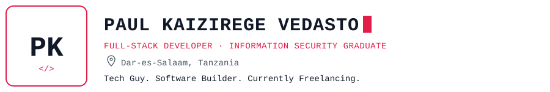
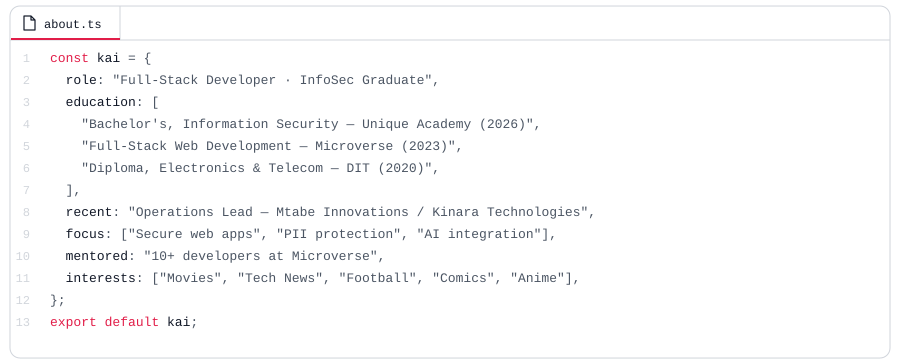
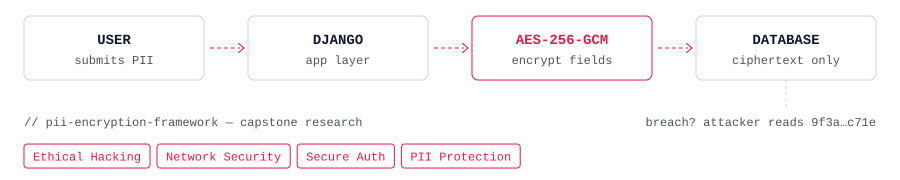
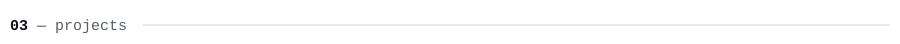
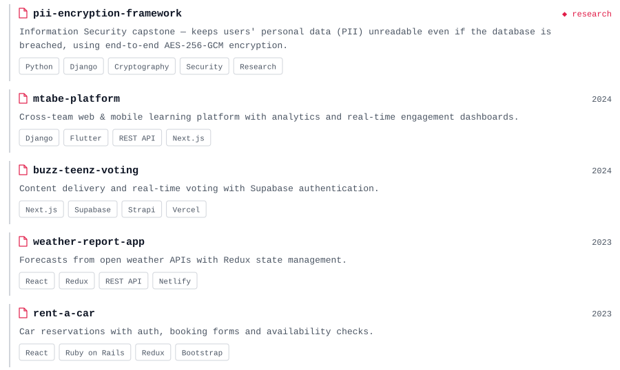
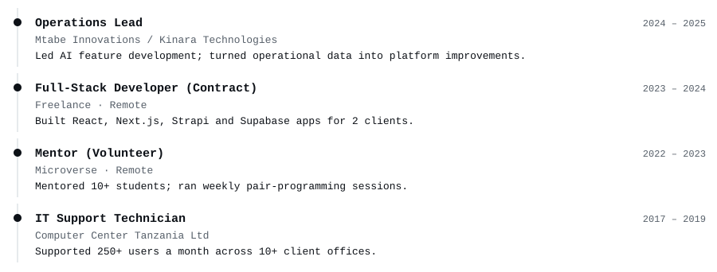
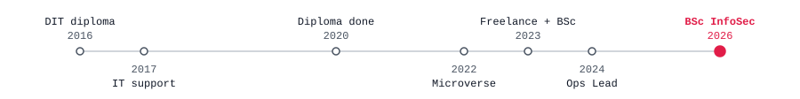
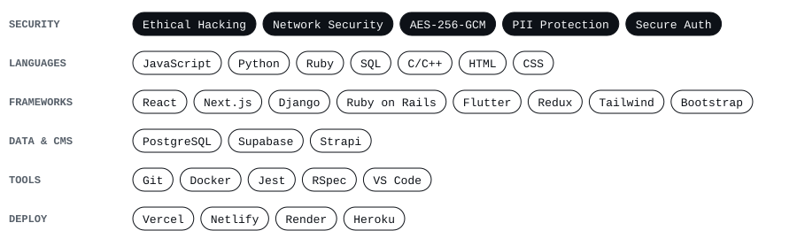
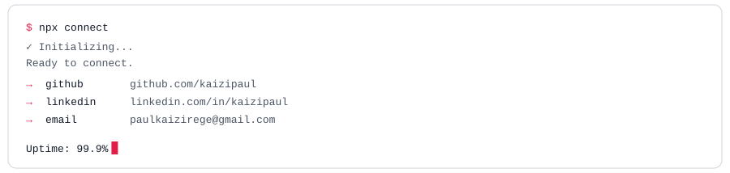

<picture><source media="(prefers-color-scheme: dark)" srcset="assets/dark/header.svg"/></picture>

<a href="https://portfolio-v3-0-plum.vercel.app/"><picture><source media="(prefers-color-scheme: dark)" srcset="https://img.shields.io/badge/PORTFOLIO-000000?style=flat-square&logo=vercel&logoColor=f43f5e&labelColor=000000"/></picture></a>
<a href="https://github.com/kaizipaul"><picture><source media="(prefers-color-scheme: dark)" srcset="https://img.shields.io/badge/GITHUB-000000?style=flat-square&logo=github&logoColor=f43f5e&labelColor=000000"/></picture></a>
<a href="https://www.linkedin.com/in/kaizipaul/"><picture><source media="(prefers-color-scheme: dark)" srcset="https://img.shields.io/badge/LINKEDIN-000000?style=flat-square&logo=linkedin&logoColor=f43f5e&labelColor=000000"/></picture></a>
<a href="mailto:paulkaizirege@gmail.com"><picture><source media="(prefers-color-scheme: dark)" srcset="https://img.shields.io/badge/EMAIL-000000?style=flat-square&logo=gmail&logoColor=f43f5e&labelColor=000000"/></picture></a>

<picture><source media="(prefers-color-scheme: dark)" srcset="assets/dark/s01.svg"/></picture>
<picture><source media="(prefers-color-scheme: dark)" srcset="assets/dark/whoami.svg"/></picture>
<picture><source media="(prefers-color-scheme: dark)" srcset="assets/dark/s02.svg"/></picture>
<picture><source media="(prefers-color-scheme: dark)" srcset="assets/dark/security.svg"/></picture>
<picture><source media="(prefers-color-scheme: dark)" srcset="assets/dark/s03.svg"/></picture>
<picture><source media="(prefers-color-scheme: dark)" srcset="assets/dark/projects.svg"/></picture>

<a href="https://portfolio-v3-0-plum.vercel.app/">portfolio-v3.0 — live ↗</a>

<picture><source media="(prefers-color-scheme: dark)" srcset="assets/dark/s04.svg"/></picture>

<picture><source media="(prefers-color-scheme: dark)" srcset="https://github-readme-stats.vercel.app/api?username=kaizipaul&show_icons=true&hide_border=true&bg_color=00000000&title_color=f43f5e&text_color=9ca3af&icon_color=f43f5e&ring_color=f43f5e"/></picture>
<picture><source media="(prefers-color-scheme: dark)" srcset="https://github-readme-stats.vercel.app/api/top-langs/?username=kaizipaul&layout=compact&langs_count=8&hide_border=true&bg_color=00000000&title_color=f43f5e&text_color=9ca3af"/></picture>

<picture><source media="(prefers-color-scheme: dark)" srcset="https://github-readme-activity-graph.vercel.app/graph?username=kaizipaul&bg_color=00000000&color=9ca3af&title_color=f43f5e&line=f43f5e&point=f3f4f6&area_color=f43f5e&area=true&hide_border=true&radius=0&custom_title=CONTRIBUTION%20TELEMETRY"/></picture>

<picture><source media="(prefers-color-scheme: dark)" srcset="assets/dark/s05.svg"/></picture>
<picture><source media="(prefers-color-scheme: dark)" srcset="assets/dark/experience.svg"/></picture>
<picture><source media="(prefers-color-scheme: dark)" srcset="assets/dark/timeline.svg"/></picture>
<picture><source media="(prefers-color-scheme: dark)" srcset="assets/dark/s06.svg"/></picture>
<picture><source media="(prefers-color-scheme: dark)" srcset="assets/dark/stack.svg"/></picture>
<picture><source media="(prefers-color-scheme: dark)" srcset="assets/dark/footer.svg"/></picture>

<!-- Panels are generated by scripts/build_assets.py: edit the DATA section there and re-run it. -->
